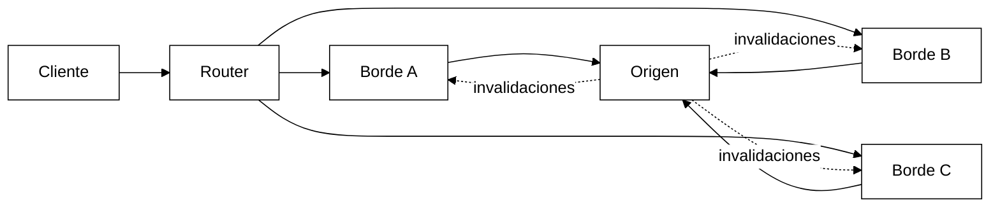
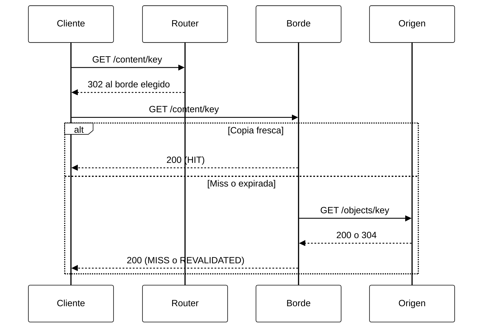
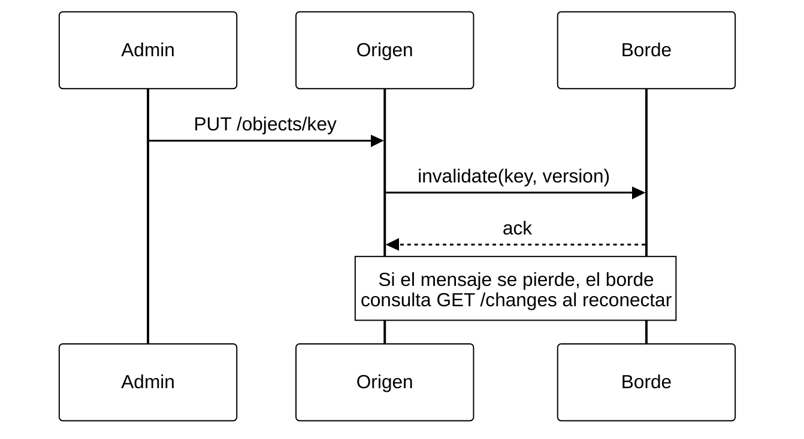
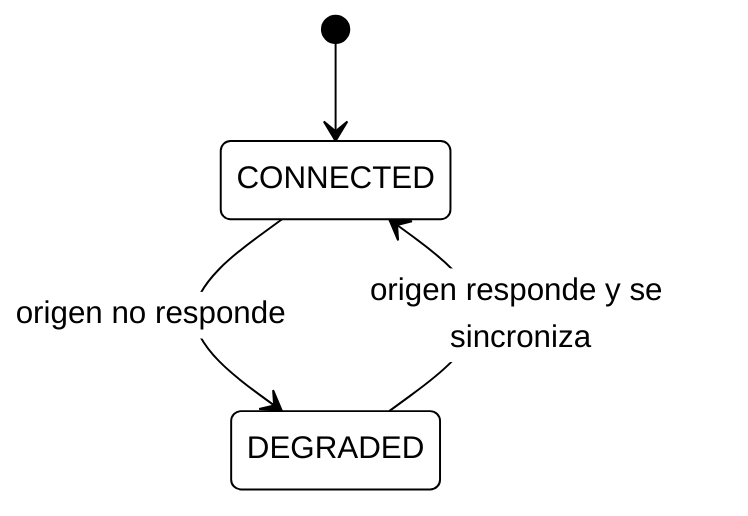

# P20 · Caché de contenido en el borde y red de distribución

Sistemas Distribuidos 2026 · Universidad de La Habana · Facultad de Matemática y Computación

## 1. Descripción general

Sistema de distribución de contenido con un **origen**, varias **cachés de borde**, **clientes** y un **selector de fuente** (router), desplegado con Docker Compose.

Las cachés acercan el contenido al cliente, pero generan copias que pueden quedar obsoletas: un borde puede seguir accesible mientras pierde comunicación con el origen, y una invalidación puede retrasarse o perderse. El proyecto **define, implementa y mide una política explícita** para esos casos, con una **cota demostrable** de obsolescencia.

### Objetivos

- Servir contenido desde el borde más apropiado según una política de selección.
- Gestionar aciertos y fallos de caché, expiración, versiones y expulsión.
- Mantener las copias coherentes mediante invalidación y revalidación.
- Tolerar la caída de bordes y del origen.
- Declarar y verificar bajo qué condición se permite servir una copia obsoleta.

## 2. Lenguaje y tecnologías

| Uso | Tecnología |
|---|---|
| Lenguaje | **Python 3.11** (todos los servicios) |
| APIs HTTP | FastAPI + uvicorn |
| Comunicación entre servicios | httpx (asíncrono) |
| Despliegue | Docker + Docker Compose (Docker Desktop con WSL2 en Windows) |
| Pruebas | pytest |
| Métricas | Endpoint `/metrics` (JSON) en cada servicio |

## 3. Diagrama de componentes



### Redes Docker (para simular particiones)

```mermaid
%%{init: {'theme':'base','themeVariables':{'background':'#ffffff','primaryColor':'#ffffff','primaryBorderColor':'#000000','primaryTextColor':'#000000','secondaryColor':'#ffffff','tertiaryColor':'#ffffff','lineColor':'#000000','textColor':'#000000','clusterBkg':'#ffffff','clusterBorder':'#000000','actorBkg':'#ffffff','actorBorder':'#000000','actorTextColor':'#000000','actorLineColor':'#000000','signalColor':'#000000','signalTextColor':'#000000','noteBkgColor':'#ffffff','noteBorderColor':'#000000','noteTextColor':'#000000','labelBoxBkgColor':'#ffffff','labelBoxBorderColor':'#000000','labelTextColor':'#000000','loopTextColor':'#000000','activationBkgColor':'#ffffff','activationBorderColor':'#000000','sequenceNumberColor':'#000000','edgeLabelBackground':'#ffffff'}}}%%
flowchart LR
    C["Cliente"] ---|"edge-net"| R["Router"]
    R ---|"edge-net"| E["Borde"]
    E ---|"origin-net"| O["Origen"]
```



Desconectar un borde de `origin-net` (`docker network disconnect`) lo deja **accesible para los clientes pero aislado del origen**: el escenario central del proyecto.

## 4. Funcionamiento

### 4.1 Petición normal (HIT, MISS y revalidación)



### 4.2 Actualización e invalidación

Tres mecanismos se complementan: si falla uno, lo cubre el siguiente.



### 4.3 Decisión del borde ante un fallo del origen

```mermaid
%%{init: {'theme':'base','themeVariables':{'background':'#ffffff','primaryColor':'#ffffff','primaryBorderColor':'#000000','primaryTextColor':'#000000','secondaryColor':'#ffffff','tertiaryColor':'#ffffff','lineColor':'#000000','textColor':'#000000','clusterBkg':'#ffffff','clusterBorder':'#000000','actorBkg':'#ffffff','actorBorder':'#000000','actorTextColor':'#000000','actorLineColor':'#000000','signalColor':'#000000','signalTextColor':'#000000','noteBkgColor':'#ffffff','noteBorderColor':'#000000','noteTextColor':'#000000','labelBoxBkgColor':'#ffffff','labelBoxBorderColor':'#000000','labelTextColor':'#000000','loopTextColor':'#000000','activationBkgColor':'#ffffff','activationBorderColor':'#000000','sequenceNumberColor':'#000000','edgeLabelBackground':'#ffffff'}}}%%
flowchart TD
    A["GET key"] --> B{"¿Copia fresca?"}
    B -->|"Sí"| H["HIT"]
    B -->|"No"| C{"¿Origen accesible?"}
    C -->|"Sí"| D["Revalidar o traer del origen"]
    C -->|"No"| E{"¿Dentro de TTL + MAX_STALE?"}
    E -->|"Sí"| S["STALE"]
    E -->|"No"| X["503"]
```

### 4.4 Estados del borde



## 5. Componentes y funciones

### Origen (`origin/`)

| Función | Descripción |
|---|---|
| `GET /objects/{key}` | Devuelve contenido con `ETag`, `X-Version` y `Cache-Control: max-age`. Soporta `If-None-Match` → `304`. |
| `PUT /objects/{key}` | Crea o actualiza (versión monótona por clave) y registra el cambio en el log. |
| `DELETE /objects/{key}` | Elimina con tombstone versionado. |
| `GET /changes?since={seq}` | Cambios posteriores a `seq`, para sincronización. |
| `POST /edges/register` | Registro de un borde para recibir invalidaciones. |
| Invalidador | Envía `invalidate` a cada borde, con reintentos y backoff. |

### Borde (`edge/`)

| Función | Descripción |
|---|---|
| `GET /content/{key}` | Flujo HIT / MISS / REVALIDATED / STALE (ver 4.1 y 4.3). |
| Caché | Entradas con `body, version, etag, stored_at, last_validated_at, ttl, invalid`; capacidad máxima en bytes. |
| Single-flight | Peticiones concurrentes a una misma clave comparten una sola ida al origen. |
| Expulsión | Interfaz común con LRU y una segunda política (LFU o FIFO) para comparar. |
| `POST /_internal/invalidate` | Recibe invalidaciones; idempotente (ignora versiones ya conocidas). |
| Sincronizador | Cada `SYNC_INTERVAL` y al reconectar pide `/changes` y aplica lo perdido. |
| Política de obsolescencia | Decide si se sirve una copia expirada (ver sección 6). |
| Cabeceras | `X-Cache`, `X-Version`, `Age`, `X-Edge-Id`. |

### Router (`router/`)

| Función | Descripción |
|---|---|
| Selección | Rendezvous hashing (afinidad de caché) y round-robin (reparto de carga). |
| Health checks | Heartbeat activo; un borde pasa a `DOWN` tras N fallos consecutivos. |
| Failover | Devuelve una lista ordenada de bordes alternativos. |

### Cliente (`client/`)

| Función | Descripción |
|---|---|
| CLI | Consultas y publicación de contenido. |
| Generador de carga | Distribución Zipf; registra latencia, hit ratio, `X-Cache` y obsolescencia observada. |

## 6. Política de contenido obsoleto

| Estado del borde | Regla | Cota de obsolescencia |
|---|---|---|
| `CONNECTED` | Solo se sirve contenido fresco o revalidado. | `≤ min(TTL, retraso de invalidación)`; si se pierde el push, `≤ SYNC_INTERVAL` |
| `DEGRADED` (sin origen) | Se sirve copia expirada solo si `now - last_validated_at ≤ TTL + MAX_STALE`. | `TTL + MAX_STALE` |
| `DEGRADED` fuera de cota | Respuesta `503` explícita. | — |

- Las respuestas obsoletas incluyen `X-Cache: STALE`, `Age` y `Warning: 110`.
- Las invalidaciones son idempotentes y las eliminaciones usan tombstones, para que una invalidación tardía no resucite un objeto borrado.
- Equivale a `stale-if-error` (RFC 5861 / RFC 9111).

## 7. Estructura del repositorio

```
p20-edge-cdn/
├── README.md
├── docker-compose.yml
├── .gitattributes             # eol=lf (importante en Windows)
├── origin/
│   ├── Dockerfile
│   ├── app.py                 # API del origen
│   ├── store.py               # almacén versionado + log de cambios
│   └── invalidator.py         # push con reintentos
├── edge/
│   ├── Dockerfile
│   ├── app.py                 # API del borde
│   ├── cache.py               # entradas, frescura, single-flight
│   ├── eviction.py            # LRU / LFU
│   ├── sync.py                # anti-entropía
│   └── stale_policy.py        # política de obsolescencia
├── router/
│   ├── Dockerfile
│   ├── app.py
│   ├── policies.py            # rendezvous, round-robin
│   └── health.py
├── client/
│   ├── cli.py
│   └── loadgen.py
├── experiments/               # escenarios de fallo y resultados
└── tests/
```

## 8. Ejecución (Windows + Docker Desktop)

```powershell
git clone <url-del-repo>
cd p20-edge-cdn
docker compose up --build -d

# Publicar y consultar (en PowerShell usar curl.exe, no curl)
curl.exe -X PUT http://localhost:8000/objects/hola -d "contenido v1"
curl.exe -i http://localhost:8080/content/hola
curl.exe -i http://localhost:8080/content/hola    # HIT
```

| Servicio | URL |
|---|---|
| Router | http://localhost:8080 |
| Origen (admin) | http://localhost:8000 |
| Bordes A / B / C (debug) | http://localhost:9001 / 9002 / 9003 |

Inyección de fallos:

```powershell
docker compose stop edge-b                                   # caída de un borde
docker network disconnect <proyecto>_origin-net <contenedor-edge-a>   # partición borde-origen
docker compose stop origin                                   # caída del origen
```

## 9. Escenarios de prueba

| # | Escenario | Se demuestra |
|---|---|---|
| E1 | Funcionamiento normal | HIT / MISS / expulsión |
| E2 | Actualización con invalidación | Retardo de propagación |
| E3 | Caída de un borde bajo carga | Failover y disponibilidad |
| E4 | Partición con contenido fresco | El borde sigue sirviendo |
| E5 | Partición con contenido expirado, dentro de `MAX_STALE` | Se sirve `STALE` |
| E6 | Partición con contenido expirado, fuera de `MAX_STALE` | `503`; nunca se supera la cota |
| E7 | Invalidación perdida | Se corrige al reconectar |
| E8 | Caída del origen | Comportamiento y recuperación |
| E9 | Comparación de políticas | Hit ratio, latencia, carga en origen |

## 10. Métricas

- **Borde:** hits, misses, revalidaciones, respuestas `STALE`, `503`, expulsiones, bytes en caché, tiempo en `DEGRADED`.
- **Origen:** peticiones recibidas, invalidaciones enviadas, fallidas y reintentadas.
- **Cliente:** latencia p50/p95/p99, hit ratio, versión recibida frente a la última publicada.

## 11. Referencias para la comparación arquitectónica

- **Varnish Cache:** proxy inverso con caché; comparar `grace` con nuestro `MAX_STALE`.
- **CDN y Cloudflare:** selección de borde, purgas distribuidas.
- **Semántica de caché HTTP (RFC 9111, RFC 5861):** frescura, validación y `stale-if-error`.
